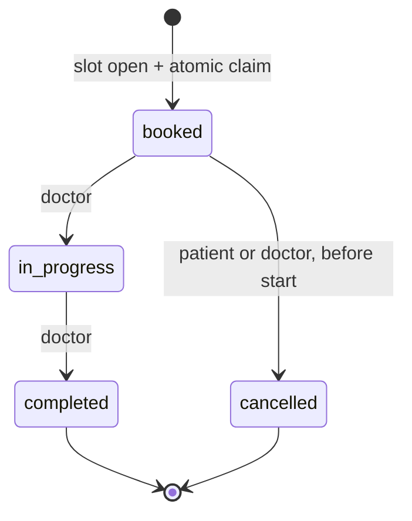

# API behavior contract

Live OpenAPI: `/openapi.json`; interactive console: `/docs`; static export: `docs/openapi.json`.

## Authentication and account state

- Patient account registration permits only patient roles. Password is Argon2id-hashed;
  a caller cannot sign up as an admin or doctor.
- Admin is bootstrapped offline (`python -m app.bootstrap`). Admin grants doctor status after
  a user has registered, with an optional separate verification step.
- JWTs contain issuer, audience, issued/expiry timestamps, random jti, subject and purpose.
  MFA challenge JWTs have a different purpose and cannot call authenticated endpoints.
- If TOTP MFA is enabled, existing pre-MFA access tokens stop working. `/auth/login` yields
  a 5-minute challenge token; `/auth/mfa/verify-login` checks a new authenticator code
  (a code may not be reused) before issuing an access token.
- Admin and doctor endpoints are locked until TOTP MFA enrollment is confirmed.
- Deactivation immediately invalidates further API access (user `is_active=false`),
  including previously issued JWTs.

## Status and booking state machines

- Each `POST /bookings` checks doctor verified and slot in the future; only one atomic UPDATE
  can turn `open` into `booked`. In the same DB transaction: consultation, pending payment,
  idempotency result, audit event, and outbox event are persisted.
- Cancellation of a future booked consultation releases the slot for reuse, preserving the
  old cancelled consultation. The partial unique index prevents >1 **active** consultation
  per slot. Cancelling a paid booking marks payment `refund_pending` (no automatic refund);
  cancelling an unpaid booking marks payment `void`.
- A doctor may add prescriptions to an `in_progress` or `completed` consultation. The
  prescription document is application-layer encrypted; access is restricted to care team.

## Write retry behavior

The `Idempotency-Key` request header is mandatory for slot creation, bookings, prescription
creation and demo payment settlement. The server stores `(user, operation, key)` and a
SHA-256 fingerprint of the canonical payload. For repeat requests:

| Condition | Result |
|---|---|
| Fresh key and accepted write | 201 for booking/slot/prescription; 200 payment |
| Same key and same request, stored result | Returns original object, no duplicate |
| Same key and different request | 409 Conflict |
| Different key but competing claim of booked slot | 409 Conflict |
| Overlapping slot for same doctor | 409 Conflict (PG database constraint) |
| Unauthenticated | 401 Unauthorized |
| Authenticated user without authorization | 403 Forbidden |
| Missing/invalid idempotency key | 422 Unprocessable Entity |
| Rate limit | 429 Too Many Requests with `Retry-After` |
| Redis limiting backend unavailable | 503 (fail-closed) |

PostgreSQL transaction-scoped advisory locks serialize two retries that have exactly the same
key. The slot row's atomic conditional update provides the separate *first-wins* guarantee
across **different** keys. The advisory lock is scoped to the booking DB transaction.

## Data and query contract

- All IDs are UUID. Stored datetimes use time-zone-aware UTC; request timestamps require an
  explicit zone offset. `available_on` and `on_date` use a UTC calendar day.
- Currency is INR; payment/consultation `fee_minor` and `amount_minor` are **paise**.
- Doctor directory search filters `specialty` and `city` (escaped case-insensitive partial
  match), optionally available date. Pagination supports offset and limit of 1..100.
- Admin analytics returns aggregated counts, not medical records.
- The demo settlement path simulates success, **not actual gateway fulfillment**.
- No PHI in HTTP access logs or async outbox payloads. Audit records hold action metadata,
  actor and resource identifiers, not prescription content.
