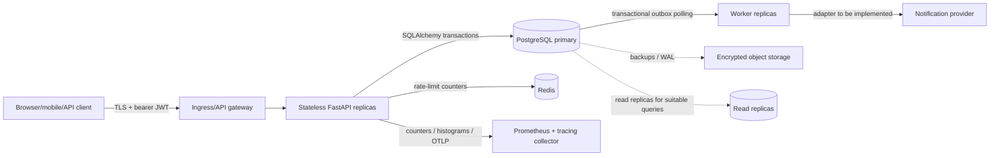
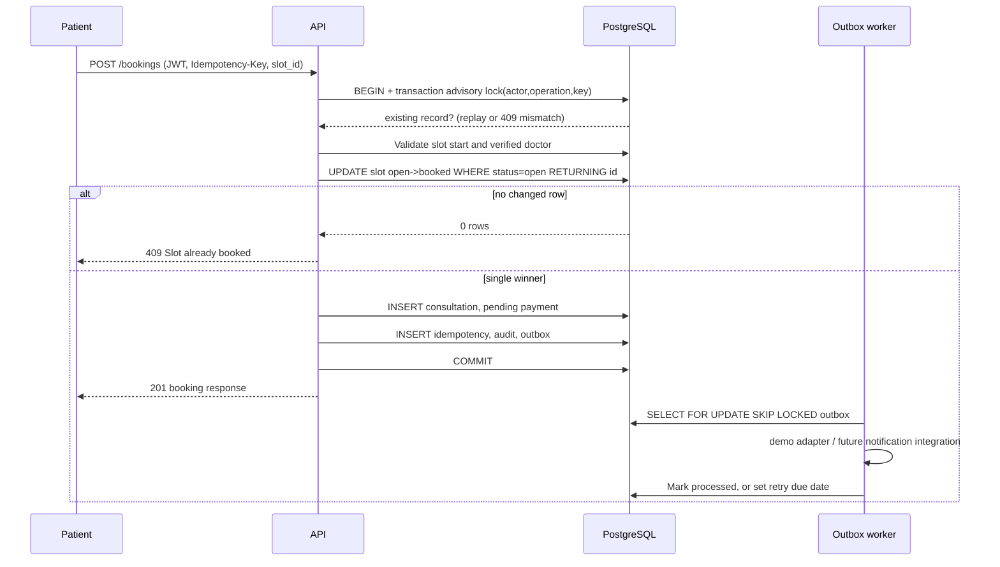
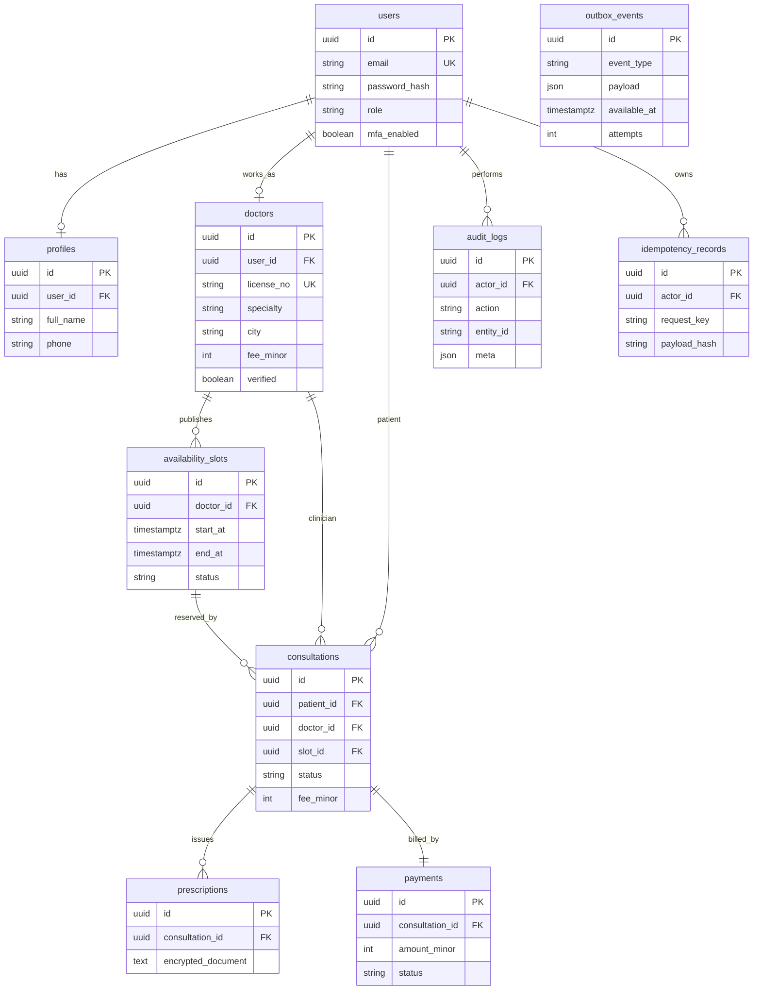

# Architecture design — Amrutam Telemedicine

**Revision:** 1.0, 27 October 2026. **Implementation:** FastAPI + SQLAlchemy + PostgreSQL 16,
Redis rate limiting, transactional outbox, containerized API/worker. **Goal:** 100k daily
consultations, p95 reads <200 ms / writes <500 ms, availability 99.95%. These are **design
objectives, not performance or SLO claims**; full benchmarking and high-availability clusters
are outside this local reference application.

## 1. High-level architecture and data flow

The request path is an HTTP API only. Stateless replicas share database and Redis; `get_db`
injects the database session into route handlers. Pydantic schemas validate request bodies;
`require_roles` enforces privilege boundaries; the patient/doctor relationship check prevents
horizontal access to medical records. Domain data is PostgreSQL's source of truth. Use a
managed multi-AZ PostgreSQL cluster and TLS termination outside the container in production.
Database driver pooling and request-level DB sessions reduce connection setup overhead.

**Booking consistency** takes priority over caching. Searches may be served from indexed
PostgreSQL and, later, short-TTL read caches. Availability is always checked in the primary
transaction at booking time, never trusted from a cached listing. A rate limit is enforced
at the application edge using Redis counters keyed by client IP and time window, with
an additional stricter auth quota. Never trust arbitrary `X-Forwarded-For`; only a trusted
proxy's verified client IP is safe.

## 2. Booking sequence and conflict handling

Two requests for the same slot but different keys contend on the conditional UPDATE;
PostgreSQL re-checks `status='open'` after row-level locking. One wins, the second receives
409. Same-key retries serialize on `pg_advisory_xact_lock` and replay a previously committed
result. Transactions also write payment + audit + outbox, removing distributed dual-write
races. Unique and partial indexes are a second layer of protection. Doctor slot creation is
protected by a `btree_gist` exclusion constraint on overlapping `tstzrange` intervals.

## 3. Logical ER model

A slot can appear in multiple **historical cancelled** consultations, but a partial
unique index (`status != 'cancelled'`) ensures at most one active consultation per slot.
All prices are integer paise, never floating-point amounts. Doctor license numbers are
unique. Users have a single current role; real multi-role organizations may need a
many-to-many account-role table as a future migration.

## 4. Transactions, retries, backoff, async jobs and sagas

**Idempotency** is implemented for nontrivial POST commands with scoped keys and canonical
request hash (see `docs/API_BEHAVIOR.md`). Application-level 409 conflicts are not retried
blindly. Clients should retry 429/503/timeouts only when safe, with bounded exponential
backoff + random jitter (e.g. 250 ms, 500 ms, 1 s, 2 s with up to 20% jitter, max 4
attempts), honoring `Retry-After` for 429. Every async notification outbox row can be
retried with `min(3600, 2**attempts)` seconds; `SKIP LOCKED` allows horizontal workers.
Outbox events contain opaque identifiers only. This demo dispatcher logs successful
processing; a real provider must provide idempotent delivery and dead-letter handling.

Payments are an explicit boundary. The **local demo** changes payment status only; it
cannot capture or refund real money. In a live saga, booking reserves a slot, a real payment
intent is created with the gateway, gateway webhooks are signature-verified and deduplicated,
and confirmation/cancellation/timeout compensations transition reservation/payment records.
Actual refunds must be asynchronous and reconciled before marking `refunded`. These
third-party steps and an event/webhook inbox are specified but **not implemented**.

## 5. Scaling, partitioning, caching and SLO verification

100k consultations/day averages about **1.16 bookings/second**, but peaks, read traffic and
concurrent retries dominate system sizing. At 10x+ busy-hour ratios, availability listing,
search, auth and audit writes produce disproportionate load. Proposed steps:

- API replicas behind a health-checked ingress, CPU/HPA scaling and connection-pool
  limits; keep concurrent PG connections below primary capacity (consider PgBouncer).
- Query plan tests (`EXPLAIN ANALYZE`) and explicit composite indexes for verified
  doctors, doctor slots, consultation ownership/status and audit chronology.
- **Future** monthly range partitions for `consultations`, `audit_logs`, and
  `outbox_events` once cardinality warrants it (e.g. 36.5 million consultations/year).
  Current tables are indexed but **not partitioned**. Partition migrations must preserve
  unique constraints and appropriate archive/retention behavior.
- **Future** Redis TTL caches for doctor directory/static specialty lists only; use
  event-driven invalidation on verification/profile changes, and bypass caches for bookings.
- Optional read replicas for analytics/search after monitoring acceptable replication lag.
  Slot claims, payment mutations, session-aware reads and idempotency use primary.
- Benchmark with realistic dataset distributions, mixed GET/POST workloads, concurrency,
  cold/warm cache, retries and failure injections. The included k6 script is a read-only
  starting smoke profile, not proof of the latency target. Measure `p95`, p99, queue lag,
  DB wait and saturation with production-like nodes; avoid exposing PII in tracing.

## 6. Observability, reliability, backup and disaster recovery

Prometheus HTTP method/templated-route/status counters and duration histograms, JSON access
logs with random request IDs, optional OpenTelemetry FastAPI traces, `/health/live` liveness
and `/health/ready` DB+Redis readiness probes are implemented. Production alerts should watch
SLO burn rate, p95 endpoint durations, 5xx rates, Redis limiter failures, DB lock wait and
connections, outbox oldest age, login failures, backup freshness and replication lag.
Instrument spans with minimal attributes; do not add PHI. Correlate downstream events using
IDs, not patient names or prescription content.

**Availability target:** 99.95% implies about 21.9 minutes downtime per 30-day month.
It requires multi-zone load balancer/API nodes, managed HA PostgreSQL synchronous or
appropriate replication, automatic failover, regional recovery planning and tested DNS/edge
fallbacks, none guaranteed by local Docker Compose. Proposed disaster recovery targets:
`RPO <=15 minutes`, `RTO <=60 minutes` for a regional disaster, subject to service tier and
contract. Use hourly or continuous WAL archiving + encrypted daily base backups, immutable
geographically separated copies, tested quarterly point-in-time restores, backup restore
access controls and key retention. The included `backup_postgres.sh` is only a **manual
unencrypted development custom-format backup**, not a production DR mechanism.

## 7. Deployment and trust boundary

Docker Compose is a reproducible single-host dev deployment. CI checks Python code,
PostgreSQL migration and constraints, dependency advisories, and container building.
The sample Kubernetes Deployments/HPA are a reference only. Production needs TLS 1.2+,
perimeter access policies, managed secrets/rotation, signed image scanning, data encryption
and key-management service, medical/compliance sign-off, zero-downtime migrations, and
performant production load tests before launch. See `SECURITY.md` for the threat model.

## Local development profile

The API and background worker can connect directly to a locally installed PostgreSQL
instance through `DATABASE_URL=postgresql+psycopg://...@127.0.0.1:5432/amrutam_local`.
No container runtime or Redis instance is required for local single-process testing.
`RATE_LIMIT_BACKEND=memory` is development-only, because its counters are not
shared across multiple API replicas. See `docs/LOCAL_DEVELOPMENT.md`.
