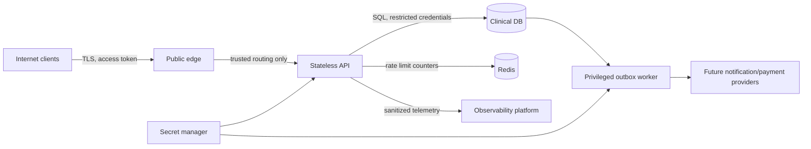

# Security checklist, privacy assumptions and threat model

**Scope:** telemedicine clinical records and booking/payment metadata; the demo is not a
certified deployment and must not hold real patient information. Date: 2026-10-27.

## Data classification and allowed visibility

| Classification | Examples | Storage / authorized access |
|---|---|---|
| Restricted clinical | prescription medicines, dosing, instructions | Fernet AES-128-CBC+HMAC authenticated encryption before DB write; decrypt for owning patient/doctor only |
| Sensitive PII | full name, phone, email, account linkage | PostgreSQL; TLS/disk/backups encryption required in production; authenticated self, restricted administrator access |
| Security secrets | password hash, MFA seed, JWT sign secret, Fernet keys, provider secrets | Argon2id password hashing; encrypted TOTP seeds; keys via environment/secret manager, never API/log output other than one-time MFA enrollment |
| Financial | integer amounts, status, opaque payment reference | care-team status views; PSP tokens/card numbers intentionally not stored |
| Operational metadata | role, doctor city, consultation identifiers, audit actor, timestamps | least-privilege RBAC; admin aggregated analytics and metadata-only audits |
| Public | verified doctor specialty/city/bio/fee and open slots | public directory endpoints |

**Note:** email, names and phone are not individually application-encrypted. Deploy with TLS
1.2+, managed PostgreSQL storage encryption, encrypted PITR backups, separation of DB roles,
and country-appropriate privacy controls. Limit or suppress PHI from logs, traces, analytics,
backups and external processors. Restrict access to private internal metrics and outbox data.

## Attack surface and trust boundaries

| Threat | Concrete impact | Implemented mitigation | Still required for production |
|---|---|---|---|
| Stolen passwords / credential stuffing | impersonation, clinical data exposure | Argon2id, login/IP throttling, TOTP MFA, short-lived JWT, role permissions | breached-password checks, bot defense, account recovery, device/session revocation, alerts |
| JWT tampering or MFA bypass | admin or patient impersonation | HS256 fixed allowlist, issuer+audience+expiration+purpose validation, MFA attestation claim, deny old pre-MFA tokens, db-side active checks | identity platform, hardware-backed key rotation, continuous MFA policy review |
| Broken object-level authorization (IDOR) | prescription/consultation of another patient | every consultation and prescription view checks patient/assigned doctor ownership | automated authorization matrix, periodic access review |
| Forged doctor / role escalation | fraudulent care | registration creates patient only, admin promotes doctors, verified flag gates public bookings, MFA required | real license authority verification and employer approval |
| Booking race / replay | overbooking / duplicate charges | conditional atomic slot UPDATE, PG partial unique active booking constraint, advisory lock and scoped idempotency records | failover/concurrency chaos tests under production traffic |
| Double write / notification loss | booking without notification | transactional outbox, worker row locking, exponential retry | provider idempotency, delivery acknowledgements, DLQ + alerts |
| Slot overlap | duplicate doctor appointments | PostgreSQL GiST time-range exclusion constraint | time zone/DST validation, doctor-specific work hours policy |
| Injection / SQLi | DB exfiltration | bound SQLAlchemy parameters, escaped LIKE inputs, strict Pydantic schemas | WAF, dynamic penetration tests |
| XSS / CSRF | token theft, state-changing calls | JSON API with bearer header, no session cookies, restricted CORS, no-store + security headers | trusted SPA CSP, input sanitization in client and output encoders |
| Abuse / denial of service | unavailable care platform | IP fixed-window Redis limiter, readiness and HPA example | edge WAF, API key/user quotas, regional limits, circuit breakers, load tests |
| Insider audit tampering | loss of accountability | audit events in same transaction, DB trigger prevents UPDATE/DELETE on audit rows in PostgreSQL | separate immutable audit sink, DB admin access alerts, WORM storage |
| Leakage in observability | regulated clinical detail exposure | logging only method, route template, status, duration, random request ID; ID-only outbox | collector redaction and restricted retention, dynamic tracing sampling |
| Key compromise | prescription/MFA decryption | env secrets, MultiFernet decryption key list, active encryption key first | vault/KMS, incident rotation, re-encryption and key-destruction plan |
| Dependency/image compromise | remote code execution | controlled Python deps, non-root Docker, pip-audit in CI | version lockfile with hashes, signed SBOM, CVE management, pinned OCI digests |
| SSRF | internal service access | no user-configurable URL fetch API | allowlisted provider connectors when introduced |
| Mass assignment | role escalation | Pydantic `extra=forbid`, explicit DTO fields and owner checks | fuzz tests, field authorization audits |

## OWASP API checklist

- [x] API1:2023 Broken Object Level Authorization — resource ownership checks for PHI.
- [x] API2 Broken Authentication — Argon2, JWT, MFA gating, IP throttle, login challenge.
- [x] API3 Broken Object Property Level Authorization — response schemas omit secret/clinical fields by default.
- [x] API4 Unrestricted Resource Consumption — bounded pagination, slot duration limits, Redis rate limiting in production; per-process in-memory rate limiting in no-Docker development (not production suitable).
- [x] API5 Broken Function Level Authorization — separate patient/doctor/admin routes.
- [x] API6 Unrestricted Access to Sensitive Business Flows — booked slot CAS + idempotency.
- [ ] API7 SSRF controls beyond lack of outbound user URLs — add allowlist when providers introduced.
- [~] API8 Security Misconfiguration — local development defaults remain unsafe on a public host;
  production secrets, reverse proxy, encryption, network policy, monitoring required.
- [~] API9 Improper Inventory Management — OpenAPI, docs, CI; add API versioning/deprecation policy.
- [~] API10 Unsafe Consumption of APIs — external gateway/notification provider currently absent;
  require verified webhooks and input signatures when integrated.

`[~]` = partially implemented, operational controls pending.

## Encryption, secrets and key rotation plan

1. `JWT_SECRET` (at least 32 characters), independent `DATA_ENCRYPTION_KEYS`, and metrics
   token generated with cryptographically secure randomness (see `docs/LOCAL_DEVELOPMENT.md`). In real
   environments, inject from Vault/AWS Secrets Manager/Azure Key Vault/GCP Secret Manager,
   never Kubernetes manifest plaintext or source control.
2. Fernet encrypts prescription JSON and TOTP seeds. `DATA_ENCRYPTION_KEYS` can contain
   comma-separated Fernet keys. The **first** key encrypts new data; later keys decrypt old
   data. To rotate: prepend a new key, deploy all nodes/workers, re-encrypt each existing
   encrypted field using the active key, verify decryptability, *then* remove old key.
   **Automated bulk re-encryption migration is not bundled.** Maintain backups/old keys
   during the transition.
3. Rotating `JWT_SECRET` immediately invalidates existing JWTs (the app supports one active
   signing key). Rotate during a planned reauthentication window or implement key identifiers
   (`kid`) with overlapping verification keys in your identity provider.
4. PostgreSQL storage, backups, WAL, and all network hops must be encrypted in production.
   Restrict backups to least-privilege operators and test secure restoration quarterly.
5. Password hashes must never be logged or exported to analytics. User passwords are never
   reversible. Audit actions store no prescription content, symptoms or card details.

## Compliance / privacy release checklist

- [ ] Assign data controller/processor roles, contract processors, privacy notice and consent
  flow for telemedicine, including India's DPDP Act and applicable medical-record guidance;
  engage qualified local legal/medical counsel to assess applicability and requirements.
- [ ] Provide patient access/rectification and lawful retention/deletion workflow. Audit
  retention and clinical retention can differ and must be legally determined.
- [ ] Run a data protection impact assessment and document data subject/guardian consent.
- [ ] Set explicit resident/region-specific clinical record storage and cross-border controls.
- [ ] Obtain licensed clinician verification; review prescription authenticity, signatures,
  contraindication rules, and emergency/triage disclaimers.
- [ ] Review tenant/clinic segregation if operating for multiple organizations.
- [ ] Verify TLS, secret store, role-scoped DB account, WAF, cluster network policy,
  immutable audit export, monitoring alerts, backup restore drills and key lifecycle.
- [ ] Complete OWASP ASVS/API testing, threat model update, SAST/DAST, dependency and
  container scanning, vulnerability remediation and incident-response exercises.
- [ ] Contract/payment review before enabling any real payment flow; never mark a payment
  `paid` merely because a client says it succeeded.
- [ ] Capture production-like p95/p99 latency and failover SLO evidence and publish an SRE runbook.

## Explicit residual risks of this prototype implementation

- Database deployment in Compose is single-node without multi-AZ, TLS or PITR.
- Distributed limits assume reliable Redis; failure is fail-closed but will affect availability.
- Token invalidation supports account deactivation and expiry, but not per-device logout / JWT denylist.
- Offline admin bootstrap credentials and CLI are intentionally for development; rotate/remove.
- TOTP setup can be phished; FIDO2/WebAuthn is preferable for high-risk clinicians/admins.
- No real payment provider, refund worker, clinical license verification service, notifications,
  regulatory consent workflow, data subject export/deletion service or SSO.
- Healthcare data should **not** be entered into a public internet deployment of this demo.
